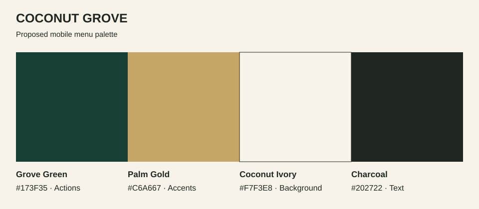

# Coconut Grove: Proposed Four-Color UI Palette

**Date:** 2026-11-06  
**Status:** Proposed design direction, not official brand specifications.

## Reference and direction

The [provided Instagram profile](https://www.instagram.com/cgpakistanofficial/) identifies the restaurant as Coconut Grove and describes a luxury dining experience. The [published logo reference](https://foodiespakistan.pk/karachi/coconut-grove-karachi-menu-with-prices-contact-information/) shows gold palm imagery on green; [restaurant imagery](https://foodoplanet.com/listing/coconut-grove/) provides warm architectural and dining references. These inform the palette below; the hex values are selected for the web UI, not extracted official brand values.



| Color | Hex | UI role |
|---|---|---|
| Grove Green | `#173F35` | Primary buttons, selected category chips, navigation accents. |
| Palm Gold | `#C6A667` | Rating stars, restrained decorative details, highlights on green. |
| Coconut Ivory | `#F7F3E8` | Main background, menu surfaces, text on green buttons. |
| Charcoal | `#202722` | Dish names, prices, ingredients, reviews, preparation time, and portion labels. |

## Application rules

- Let ivory dominate the interface and food photography provide most visual variety. Use charcoal for information, green for interaction, and gold sparingly.
- The main “View on your table” button uses green with ivory text. Secondary actions use ivory with green text and a green outline.
- Use green fills with ivory text for selected categories; make selection apparent through shape/border and state labels as well as color.
- Use charcoal text beside gold rating stars. Present spice level with a label and icons or a numeric scale rather than relying on a red-to-green gradient.
- Keep ingredient and allergen information readable in charcoal. Do not encode safety-critical meaning through color alone.
- Over a live camera preview, place controls on opaque green or ivory panels so readability does not depend on the scene behind them.
- Separate surfaces through spacing and outlines; extra palette colors are unnecessary for this initial direction. Future semantic error/success tokens can be designed separately if needed.

## Checked text contrast

Calculated using WCAG relative luminance for opaque sRGB colors:

| Pair | Ratio | Normal text |
|---|---|---|
| Charcoal / ivory | 13.78:1 | Passes AA |
| Green / ivory | 10.53:1 | Passes AA |
| Charcoal / gold | 6.58:1 | Passes AA |
| Gold / green | 5.03:1 | Passes AA |
| Gold / ivory | 2.09:1 | Avoid for text or essential standalone icons |

These checks cover solid color pairings, not the accessibility of a complete interface or translucent controls.

## CSS tokens

```css
:root {
  --color-primary: #173F35;
  --color-accent: #C6A667;
  --color-background: #F7F3E8;
  --color-text: #202722;
}
```
