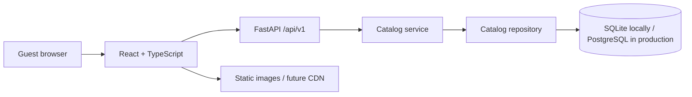

# React + FastAPI architecture

The Coconut Grove site uses independent Intro, Menu and Preview routes with a shared fixed navbar and a database-backed API. It supports concurrent public browsing and gives future brand features a clear place to live. It does not implement user accounts or claim production capacity without load testing. The [page update](./PAGE_UPDATE.md) documents the published menu reference, provenance, nullable unknown facts and lazy-loaded 3D demonstration.

## Request flow

Vite proxies `/api` to FastAPI in development. In production, FastAPI can serve the React build on the same origin. Separate frontend hosting is also possible with `VITE_API_BASE_URL` and an exact backend CORS allowlist. React replaces the original imperative DOM implementation.

## Boundaries

| Layer | Responsibility |
|---|---|
| [Frontend components](./frontend/src/) | Layout, dialogs, filters, portions and local favorites; React escapes rendered API text. |
| [API client](./frontend/src/api.ts) | Versioned requests, errors, debounced search and cancellation of superseded requests. |
| [API routes](./backend/app/api/routes.py) | HTTP validation, bounded pagination, request-scoped sessions, response contracts. |
| [Catalog service](./backend/app/services/catalog.py) | Published-menu behavior, missing records and serialization. |
| [Repository](./backend/app/repositories/catalog.py) | Restaurant-scoped database queries, literal substring search, eager loading of portions. |
| [Models](./backend/app/models.py) | Restaurants, ordered categories, published dishes and portion variants. Integer minor currency units avoid floating-point prices. |
| [Migrations](./backend/migrations/) | Explicit versioned schema changes, run once per release rather than by each worker at startup. |
| [Reference importer](./backend/app/import_menu.py) | Offline, repeatable source import that preserves edits and hides known samples. |

Ingredients use a typed JSON array per dish. Normalize them when actual ingredient-management requirements emerge. There are no public catalog writes or fake review persistence.

## Concurrent users and scaling

- Workers share database records, not mutable per-guest global sessions. Each request opens and closes a SQLAlchemy session.
- Use PostgreSQL for production concurrency and durable writes. SQLite is for local development/tests, not horizontal scaling.
- Bound page sizes and saved-ID lists. Scope menu reads by restaurant; hide unpublished dishes in detail, review and AR lookups too.
- Favorites remain browser-local, without accounts or cross-device sync. Up to 100 favorites can be queried and paginated through the API.
- Engines use pooling and pre-ping. Size total worker/replica pools against the database connection budget.
- No per-process menu cache means catalog changes do not require cache invalidation across workers. Add measured caching and indexed full-text search when catalog size/traffic justify it; ingredient JSON scanning is a current limitation.
- Move imagery and future 3D assets to a CDN/object store as needed. Fetch models on demand.
- Liveness and readiness are separate. Readiness checks schema access; deployment smoke tests should also confirm the expected restaurant catalog exists.

## Future authenticated brand platform

Concurrent diners are supported by this foundation. Authenticated users, staff roles and private multi-tenant data require additional work.

Before adding private/write APIs, implement an established identity/session system, server-verified identities, restaurant-scoped memberships and role checks, appropriate rate limits and CSRF protection, and audit records for publishing. CORS is not authentication. Client-provided roles and restaurant IDs cannot grant access.

Future domain modules:

- **Identity and memberships:** guest accounts, restaurant staff, admins, recovery and privacy controls.
- **Publishing:** draft/review/publish workflow, approved recipes/media, branch availability and audit history.
- **Reviews:** verifiable visits, durable submissions, moderation and abuse controls. Only approved reviews affect ratings.
- **AR assets:** measured portion-specific GLB/USDZ records and approval state; asynchronous processing when uploads exist.
- **Location operations:** branch menus, kitchen estimates and integrations, with live claims only after connection.

The URL restaurant ID scopes public catalog reads. It is not a complete tenant-isolation system for private data. Staff multi-tenancy needs authorization tests and additional database constraints before launch.

## Deployment and limits

[Dockerfile](./Dockerfile) builds React and runs FastAPI as a non-root user. [Compose](./compose.yaml) provides PostgreSQL and a one-shot migration service. Sample seeding is explicit. Container/PostgreSQL execution is not verified in this environment because Docker is unavailable.

The retained Sites registration is a static frontend target, not a Python host. Its manifest now points at the React build; publishing there would require a separately hosted API and configured frontend API origin. No upload or deployment was attempted in this migration.

Before production: approve restaurant data and image rights, verify hosting, configure secrets/TLS/backups/monitoring, test PostgreSQL and sustained concurrent load, and implement authentication/moderation before accepting user writes. Restaurant dish AR, accounts and live kitchen data remain planned; the separate Preview page already provides an interactive sample model.
